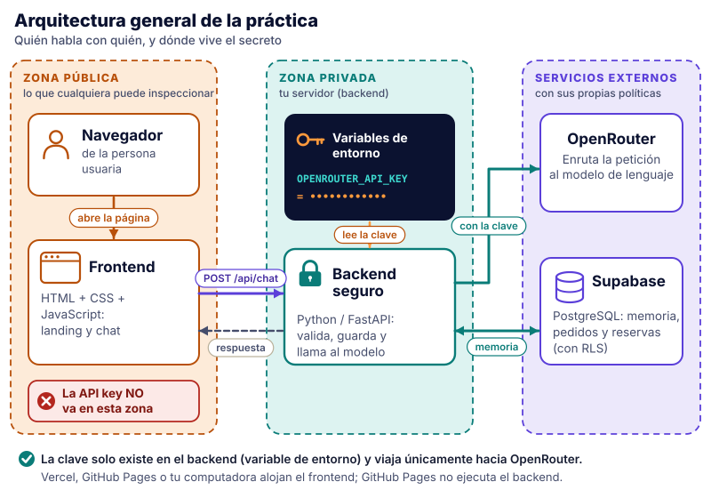
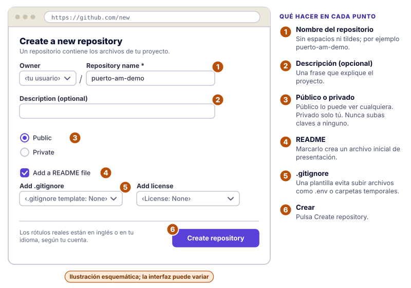

# Sistema visual E1601.2 — Contrato para redactores de guías

Motor: **WeasyPrint 70** (HTML + CSS de impresión). Papel **A4** (márgenes laterales de 20 mm: imprime bien en carta).
Todo lo que necesitas está en esta carpeta (`fuentes_editables/design/`):

| Archivo | Para qué |
|---|---|
| `theme.css` | Estilos de todos los componentes (no lo copies: `build.py` lo inyecta). |
| `build.py` | Compila `guia.html` → PDF, genera TOC, marcadores, metadatos, renders y hoja de contactos. |
| `plantilla_guia.html` | Guía de muestra con TODOS los componentes. **Copia este archivo** como punto de partida. |
| `gen_diagramas.py`, `gen_esquemas_ui.py`, `svgkit.py` | Generan los SVG originales de `recursos_visuales/diagramas/`. |
| `assets/placeholder_captura.png` | Imagen de marcador (solo para pruebas; nunca en una guía final). |

## 1. Compilar

```bash
cd fuentes_editables/design
python3 build.py ../guias/01_openrouter.html ../../01_OPENROUTER_DESDE_CERO_E1601_2.pdf
```

Opciones: `--no-render` (sin PNG), `--depth 3` (TOC con h3), `--ua` (intenta PDF/UA-1), `--dump-html` (guarda el HTML procesado junto al PDF).

Salida en consola: **páginas**, advertencias de WeasyPrint (imágenes/fuentes faltantes), **enlaces internos rotos** (`href="#id"` sin destino), `` sin `alt`, páginas casi vacías. Además escribe, en `evidencias_qa/render/<nombre_del_pdf>/`:
`p-01.png …` (60 dpi), `contactos_01.png …` (hojas de miniaturas, 24 páginas por hoja) y `enlaces_externos.txt` (lista única de URLs externas para verificar).

Las rutas relativas de imágenes se resuelven desde la carpeta del HTML. Desde `fuentes_editables/guias/` los diagramas son `../../recursos_visuales/diagramas/xxx.svg` y las capturas `../../recursos_visuales/capturas/xxx.png`.

**Regla de calidad:** no entregues un PDF sin abrir (con la herramienta Read) la portada, la TOC, una página densa, una de código, una de tablas y la final.

## 2. Esqueleto de una guía

```html
<!doctype html>
<html lang="es">
<head>
  <meta charset="utf-8">
  <title>OpenRouter desde cero · Top Learning E1601.2</title>
  <meta name="description" content="Una frase: qué aprende quien lee esta guía.">
  <meta name="keywords" content="OpenRouter, API key, E1601.2, ...">
</head>
<body data-guide-title="OpenRouter desde cero">   <!-- texto del encabezado corrido -->

  <section class="cover" data-guide-number="01"> … </section>
  <section class="toc-page"><h1 class="toc-title">Contenido</h1><nav class="toc" data-auto></nav></section>
  <section class="chapter unnumbered" id="como-usar"> … </section>   <!-- "Cómo usar esta guía" -->
  <section class="chapter"> … </section>                             <!-- capítulos numerados 01, 02… -->
  <section class="chapter unnumbered"> índices, checklist, quiz, glosario </section>
  <section class="rescue"> … </section>
  <section class="credits"> … </section>
</body></html>
```

Metadatos del PDF: `build.py` pone autor «Kevin Daniel Martínez Orozco · Top Learning», título (de `<title>`), asunto/descripción y palabras clave (de los `<meta>`), fecha 2026-11-23 y PDF etiquetado (accesibilidad).

## 3. Convenciones obligatorias

- **IDs:** `build.py` genera los que falten. Pon ID manual (estable, en minúsculas, sin tildes) a lo que vayas a enlazar desde otras páginas: `<h2 id="crear-api-key">`. IDs de componentes con prefijo: prompts `P-OR-01` (OR = OpenRouter, GH, VC, SB, MA = guía maestra), errores `E-OR-01`, ejercicios `X-OR-01`. Estos IDs alimentan los índices cortos.
- **Numeración:** automática. Cada `section.chapter` se numera `01, 02…` y sus `h2` `1.1, 1.2…`. No escribas números a mano. `class="unnumbered"` en la sección = sin número (rescate, glosario, índices). `class="no-toc"` en un `h2`/`h3` = no aparece en la TOC ni en los marcadores.
- **Un solo `h1.chapter-title` por capítulo**, dentro de `header.chapter-head`. Usa `h2` para secciones, `h3` para subsecciones, `h4` para rótulos pequeños. No saltes niveles.
- **Etiquetas de contenido:** `<span class="tag en-clase"></span>` (vacía: el texto se rellena solo). Clases válidas: `en-clase`, `prompt-mejorado`, `complemento`, `actualizacion`, `demo`, `pendiente`, `aclaracion`, `reconstruccion`. Van **al inicio del párrafo o bloque** al que califican.
- **Fuentes oficiales y verificación** (obligatorio para comandos, precios, límites, pantallas):
  ```html
  <div class="sources"><span class="label">Fuente oficial</span>
    <a class="src" href="https://docs.ejemplo.com/ruta">docs.ejemplo.com/ruta</a>
    <span class="verified">verificado 23/11/2026</span></div>
  ```
  El texto visible del enlace es la URL (se imprime). Nunca enlaces a una URL personal de alumnos ni a trycloudflare/codespaces/`*.github.io` de alumnos.
- **Capturas reales vs. esquemas:** captura real = `.screenshot` (con insignia «Captura real», fuente y fecha). Esquema propio = `.figure.schematic` (rótulo «Ilustración esquemática; la interfaz puede variar» automático). **Nunca** presentes un esquema como captura ni muestres sesiones iniciadas, correos, claves, códigos 2FA o datos de alumnos.
- **Simulación académica:** todo dato de Puerto A&M lleva `<span class="sim-badge">Simulación académica</span>` junto al título de la tabla/KPI (no dentro de `h2`/`h3`, para que no entre en la TOC).
- **Texto alternativo:** toda `` lleva `alt` descriptivo (se avisa si falta). Para los diagramas copia el `<desc>` de `recursos_visuales/diagramas/ALT_TEXT.md`.
- **Privacidad:** usa los códigos Alumna A … Alumno J / «otro participante». El profesor sí se nombra.
- **Secretos:** solo placeholders: `OPENROUTER_API_KEY=` vacío o `sk-or-v1-XXXXXXXX…`. En bloques de código, marca un valor sensible de ejemplo con `<span class="secret">`.
- **No uses** `style=""` salvo excepciones puntuales de margen. Si necesitas algo nuevo, pídelo al sistema visual en vez de inventar clases.

## 4. Componentes (HTML exacto)

### 4.1 Portada `.cover`
```html
<section class="cover" data-guide-number="01">
  <div class="cover-top"><span class="brand">Top Learning</span><span>Biblioteca de clase · E1601.2</span></div>
  <div class="cover-main">
    <p class="kicker">Guía 01 de 05 · OpenRouter</p>
    <h1 class="cover-title">OpenRouter desde cero</h1>
    <p class="cover-subtitle">De cuenta nueva a primera respuesta del modelo, sin exponer tu API key.</p>
  </div>
  <dl class="cover-meta">
    <div><dt>Grupo</dt><dd>E1601.2 — Inteligencia Artificial</dd></div>
    <div><dt>Módulo</dt><dd>Vibe Coding y Análisis de Datos · Semana 13/28, Nivel 1</dd></div>
    <div><dt>Profesor</dt><dd>Kevin Daniel Martínez Orozco —<br>Profesor de IA Aplicada y Automatización</dd></div>
    <div><dt>Número de guía</dt><dd>Guía 01 de 05</dd></div>
    <div><dt>Fecha de la clase</dt><dd>Fecha de la clase: 22/11/2026</dd></div>
    <div><dt>Verificación técnica</dt><dd>Verificación técnica: 23/11/2026</dd></div>
  </dl>
</section>
```
Títulos de portada: ≤ 60 caracteres (2 líneas a 42 pt). Subtítulo ≤ 140 caracteres. `build.py` inserta la ilustración de nodos y el número grande automáticamente. La portada no lleva encabezado ni pie.

### 4.2 Tabla de contenido `nav.toc` e índices cortos
```html
<section class="toc-page"><h1 class="toc-title">Contenido</h1><nav class="toc" data-auto></nav></section>
<nav class="toc-mini" data-auto="prompts"></nav>     <!-- también "errors" y "exercises" -->
```
Se generan solas con números de página (`target-counter`), enlaces clicables y marcadores PDF. Opcional `data-title="Índice de prompts de esta guía"`.

### 4.3 Capítulo `.chapter`
```html
<section class="chapter" id="cap-crear-cuenta">
  <header class="chapter-head">
    <p class="chapter-kicker">Parte 1 · Cuenta y seguridad</p>
    <h1 class="chapter-title">Crea tu cuenta y tu primera API key</h1>
    <p class="lead">Una o dos frases con la promesa del capítulo, con <strong>lo clave en negrita</strong>.</p>
    <div class="chapter-meta"><span><b>Tiempo estimado</b> 25 min</span><span><b>Dificultad</b> Básica</span><span><b>Necesitas</b> Navegador y cuenta gratuita</span></div>
  </header>
  <h2>…</h2> …
</section>
```
Cada `.chapter` empieza en página nueva. `class="chapter cont"` continúa sin salto. `class="chapter opener-page"` crea una apertura a página completa oscura (úsalo, como mucho, en 3-4 capítulos de la guía maestra).

### 4.4 Patrón instruccional de cada sección
`problema → concepto → por qué importa → pasos con capturas → prompt → prueba observable → resultado esperado → errores frecuentes → solución y plan B`. Usa `h2` para la sección y `h3` para sus fases («Prueba observable», «Resultado esperado», «Si falla»).

### 4.5 `.lead`, callouts
```html
<p class="lead">Texto de entrada.</p>
<aside class="callout info"><p class="callout-title">Dato útil</p><p>…</p></aside>     <!-- info | tip | warning | danger | note -->
```
Máximo 4 callouts por página impresa; ≤ 6 líneas cada uno.

**Tarjeta roja de API key** (obligatoria en toda guía que toque claves; al menos una vez en el capítulo de seguridad y en la guía maestra):
```html
<aside class="callout key-warning">
  <p class="callout-title">NUNCA pegues una API key en un chat, en el frontend ni en GitHub.</p>
  <p>Solo vive en el backend, en una variable de entorno. Si la expones, <strong>revócala de inmediato</strong> y crea otra.</p>
</aside>
```

### 4.6 Pasos `.steps`
```html
<ol class="steps">
  <li>
    <p class="step-title">Abre el panel de claves</p>
    <p>Descripción breve y exacta de qué botón pulsar (nombre del botón en <span class="ui">Create Key</span>).</p>
    <p class="expect">una ventana con el campo «Nombre».</p>     <!-- se imprime «Debes ver: …» -->
  </li>
</ol>
```
Un paso = una acción. Dentro de un paso puedes poner `.terminal`, `pre.code`, `figure`. ≤ 8 pasos por lista (divide si hay más). Teclas: `<kbd>Ctrl</kbd>`; nombres de botón/campo: `<span class="ui">…</span>`; código en línea: `<code>…</code>`.

### 4.7 Bloque de prompt `.prompt-box`
```html
<div class="prompt-box" id="P-OR-01">
  <div class="prompt-head">
    <span class="prompt-id">P-OR-01</span>
    <span class="prompt-title">Título corto y accionable</span>
    <span class="prompt-meta"><b>Herramienta:</b> OpenCode / Claude Code / ChatGPT &nbsp;·&nbsp; <b>Dificultad:</b> <span class="diff d2"></span> &nbsp;·&nbsp; <b>Tiempo:</b> 10 min</span>
  </div>
<pre>Texto EXACTO del prompt (se conserva el espacio en blanco, ajusta las líneas largas).
Los caracteres &lt; &gt; &amp; se escriben como entidades HTML.</pre>
  <p class="prompt-foot">Qué debes comprobar antes de pegarlo (p. ej. «no incluye ninguna clave»).</p>
</div>
```
`diff d1/d2/d3` = Básica / Intermedia / Avanzada (texto + puntos). Variante `class="prompt-box bad"` (borde rojo) para mostrar un prompt **malo** como contraejemplo. Los prompts de más de ~17 líneas se convierten automáticamente a una tabla con **cabecera repetida** si cruzan de página; los cortos nunca se parten. Etiqueta el origen con `<span class="tag prompt-mejorado"></span>` o `en-clase` en el párrafo previo.

### 4.8 Código y terminal
```html
<pre class="code" data-file="main.py"><span class="c"># comentario</span>
<span class="k">def</span> saludar(): <span class="k">return</span> <span class="s">"hola"</span></pre>
```
Clases de resaltado: `.c` comentario, `.k` palabra clave, `.s` cadena, `.n` número, `.secret` valor sensible de ejemplo. `data-file` muestra el nombre de archivo arriba.

```html
<div class="terminal">
  <div class="term-bar">Windows PowerShell</div>
<pre><span class="p">PS C:\Users\alumno\puerto-am&gt;</span> <span class="k">python --version</span>
<span class="o">Python 3.12.x</span></pre>
</div>
```
`.p` prompt, `.k` comando, `.o` salida, `.ok` éxito, `.err` error, `.c` comentario. Para bloques largos (> 26 líneas) `build.py` añade `.split` y permite partir entre páginas; los demás nunca se parten. Un bloque `.terminal` = un conjunto coherente de comandos con su salida esperada.

### 4.9 Tarjeta de error `.error-card`
```html
<div class="error-card" id="E-OR-01">
  <div class="error-head"><span class="error-id">E-OR-01</span><span class="error-title">Respuesta 401 al llamar al modelo</span></div>
  <dl>
    <div><dt class="e-error">Error</dt><dd>Qué ve la persona (texto exacto del mensaje).</dd></div>
    <div><dt class="e-cause">Causa probable</dt><dd>…</dd></div>
    <div><dt class="e-test">Prueba</dt><dd>Cómo confirmar la causa sin romper nada.</dd></div>
    <div><dt class="e-fix">Reparación</dt><dd>Pasos concretos; plan B.</dd></div>
  </dl>
</div>
```

### 4.10 Tablas `.table`
```html
<table class="table">
  <caption>Título opcional de la tabla</caption>
  <thead><tr><th>Concepto</th><th>Qué hace</th><th>Dónde</th></tr></thead>
  <tbody><tr><td>Frontend</td><td>…</td><td class="ok">Sí</td></tr></tbody>
</table>
```
**Máximo 5 columnas**, celdas ≤ 3 líneas, sin tablas anidadas. Celdas de estado: `class="ok|no|warn"` (siempre con texto: «Sí», «No»…). Las cabeceras se repiten entre páginas y las filas no se parten. Columna numérica: `class="num"`.

### 4.11 Figuras
```html
<!-- Diagrama propio -->
<figure class="figure">
  
  <figcaption>Qué enseña la figura en una frase.<span class="credit">Diagrama original · Top Learning E1601.2</span></figcaption>
</figure>

<!-- Esquema de interfaz (los 7 esquemas SVG ya traen el rótulo dentro de la imagen) -->
<figure class="figure schematic inline-label">
  
  <figcaption>…</figcaption>
</figure>
<!-- Si el esquema NO trae el rótulo propio (p. ej. un PNG), omite "inline-label": el CSS añade el rótulo automáticamente. -->

<!-- Captura REAL de una página pública -->
<figure class="screenshot">
  <div class="shot-frame">
    <div class="browser-bar"><span class="dots"></span><span class="url">https://docs.ejemplo.com/pagina</span></div>
    
  </div>
  <figcaption><span class="shot-badge">Captura real</span>Qué muestra y qué botón pulsar.<span class="credit">Fuente: docs.ejemplo.com · capturada el 23/11/2026</span></figcaption>
</figure>
```
Numeración «Figura N.» automática. Variantes: `figure.figure.narrow` (75 % de ancho), `figure.figure.tall` (imagen vertical, alto máx. 190 mm). Las figuras no se parten: si una figura grande cae al final de página y deja un hueco, muévela antes del párrafo anterior o usa `.narrow`. Altura máxima útil de una figura: 235 mm.

**Incluir SVG:** siempre con `` (texto del SVG sigue siendo seleccionable y las fuentes se embeben). No pegues SVG en línea salvo necesidad. Ancho nativo de los SVG: 800 unidades → a 170 mm el texto mínimo mide ≈ 7,8 pt.

### 4.12 Checklist, quiz y respuestas
```html
<div class="checklist-box"><h3>Puedo…</h3>
  <ul class="checklist"><li>Explicar qué hace el backend.</li><li>…</li></ul></div>

<ol class="quiz">
  <li><p class="q">Pregunta</p><ul class="options"><li>Opción A</li><li>Opción B</li><li>Opción C</li></ul></li>
</ol>
<div class="answers"><h3>Soluciones</h3><ol><li><strong>B.</strong> Justificación breve.</li></ol></div>
```
Mini evaluación: 4–6 preguntas, 2–4 opciones; las soluciones siempre con explicación de una línea.

### 4.13 Glosario
```html
<dl class="glossary">
  <div><dt>API key <span class="en">(clave de API)</span></dt><dd>Definición de 1–3 líneas.</dd></div>
</dl>
```
Dos columnas; cada entrada no se parte. Orden alfabético.

### 4.14 Línea de tiempo, KPIs, columnas, comparaciones
```html
<ol class="timeline approx">          <!-- "approx" añade ≈ a las horas -->
  <li><span class="t-time">00:20</span><span class="t-title">Dashboard</span><p>Descripción.</p></li>
</ol>

<div class="kpi-grid">                 <!-- c2 | c3 | (4 por defecto) -->
  <div class="kpi"><span class="kpi-value">$184,520</span><span class="kpi-label">Ingreso</span><span class="kpi-note">Σ cantidad × precio</span></div>
</div>

<div class="two-col"><div>…</div><div>…</div></div>          <!-- también .three-col -->

<div class="comparison">               <!-- c3 para tres columnas -->
  <div class="compare-col good"><h4>Correcto</h4><div class="compare-body"><ul><li>…</li></ul></div></div>
  <div class="compare-col bad"><h4>Incorrecto</h4><div class="compare-body"><ul><li>…</li></ul></div></div>
</div>
```
`compare-col` admite `good`, `bad`, `neutral`. Mantén `two-col`/`comparison` cortos (< 12 líneas por columna) porque no se parten entre páginas. Los KPIs de Puerto A&M van siempre con insignia de simulación.

### 4.15 Ejercicio graduado `.exercise`
```html
<div class="exercise" id="X-OR-01">
  <div class="exercise-head"><span class="exercise-id">X-OR-01</span><span class="exercise-title">Título</span><span class="exercise-level">Nivel 1 · 15 min</span></div>
  <div class="exercise-body"><dl>
    <dt>Estado inicial</dt><dd>…</dd><dt>Acciones</dt><dd>…</dd><dt>Salida esperada</dt><dd>…</dd><dt>Diagnóstico</dt><dd>…</dd>
  </dl></div>
</div>
```

### 4.16 Página de rescate «Si te atoras, haz esto»
```html
<section class="rescue">
  <div class="rescue-head"><p class="rescue-kicker">Página de rescate</p><h2>Si te atoras, haz esto</h2><p>Frase de apoyo.</p></div>
  <div class="rescue-block"><span class="meta">Paso 1 · 2 minutos</span><h3>¿Responde la interfaz?</h3><ol><li>…</li></ol></div>
  <!-- 3–5 bloques; el último, «Plan B: pide ayuda con un mensaje útil» -->
</section>
```
Ocupa **una** página (no más de 5 bloques). Para la guía maestra, repite el componente por punto de interrupción (00:27, 01:11, 02:09…) con `h2` propio.

### 4.17 Créditos y aviso final
```html
<section class="credits">
  <h2>Créditos y aviso</h2>
  <p><strong>Autoría:</strong> Kevin Daniel Martínez Orozco — Profesor de Inteligencia Artificial Aplicada y Automatización. Grupo E1601.2 — Inteligencia Artificial, Top Learning.</p>
  <p><strong>Fechas:</strong> clase del 22/11/2026; verificación técnica del 23/11/2026.</p>
  <h3>Aviso</h3><p>Simulación académica, precios y pantallas variables, sin patrocinio de las plataformas…</p>
  <div class="brand-foot"><span>Top Learning</span><span>E1601.2 · Inteligencia Artificial</span><span>23/11/2026</span></div>
</section>
```
Página oscura a sangre, sin encabezado/pie. Debe ser la última.

### 4.18 Utilidades
`.keep` (no partir), `.break-before`, `.break-after`, `.small`, `.muted`, `.mono`, `.nowrap`, `.pill` (`teal|orange|red`), `.mt0`/`.mb0`, `.spacer`. `mark` resalta, `kbd` teclas, `blockquote` + `<cite>` para citas literales de la transcripción (señálalas como tales).

## 5. Reglas de partición y límites

| Elemento | Comportamiento / límite |
|---|---|
| Encabezados | Nunca quedan solos al final de página (`break-after: avoid`). |
| Párrafos | `orphans/widows: 3`. |
| Callout, error-card, kpi, quiz-item, rescue-block, figura, paso | **No se parten.** Mantén cada uno < 1/3 de página. |
| `pre.code` / `.terminal` | No se parten salvo > 26 líneas (`.split` automático). **Líneas ≤ 90 caracteres** (se ajustan, pero lee mal). Máximo ≈ 45 líneas por bloque: divide en archivos o pasos. |
| `.prompt-box` | Cortos (< 17 líneas) no se parten; largos se parten con cabecera repetida. **Líneas ≤ 88 caracteres.** |
| Tablas | Cabecera repetida; filas no se parten; **≤ 5 columnas**; texto ≥ 8,8 pt. |
| Figuras | ≤ 235 mm de alto; no se parten. |
| Capítulo | Cada uno empieza en página nueva; evita capítulos de < 2 páginas (usa `chapter cont`). |
| Página vacía | Si `build.py` marca «casi vacías», reordena o fusiona contenidos. |

Tipografía: Inter (texto), Inter Display (títulos), JetBrains Mono (código). Cuerpo 10 pt, interlineado 1,58. Paleta (tokens en `:root`): `--midnight #0B1230`, `--violet #5B3FD9`, `--teal #0A7C78`, `--orange #B8500A`, marfil `#FBF8F1`; todos los pares texto/fondo cumplen contraste AA.

## 6. Catálogo de diagramas (`recursos_visuales/diagramas/`)

Cada SVG lleva `<title>` y `<desc>`; los textos alternativos completos están en `ALT_TEXT.md`.

| Archivo | Úsalo en |
|---|---|
| `arquitectura_general.svg` | Todas las guías: navegador → frontend → backend seguro (candado, key en variables de entorno) → OpenRouter / Supabase |
| `arquitectura_4_niveles.svg` | Guía maestra y capítulo de contexto del curso |
| `localhost_vs_pages_vs_vercel.svg` | Guías 02, 03 y maestra |
| `excel_fastapi_dashboard_asistente.svg` | Guía maestra (dashboard) |
| `modelo_datos_memoria.svg` | Guía 04 y maestra (alineado con `sql/01_schema_memoria.sql`) |
| `flujo_turno_memoria.svg` | Guía 04 y maestra |
| `flujo_depuracion_chat.svg` | Guías 01, 03 y maestra («el chat no responde») |
| `flujo_seguro_api_key.svg` | Guía 01 y maestra (incorrecto vs correcto) |
| `github_web_vs_cli.svg` | Guía 02 |
| `vercel_preview_vs_production.svg` | Guía 03 |
| `linea_tiempo_sesion.svg` | Guía maestra (minutos aproximados) |
| `n8n_futuro_no_implementado.svg` | Guía maestra, solo como «arquitectura futura» |
| `esquema_openrouter_crear_api_key.svg` | Guía 01 |
| `esquema_github_new_repository.svg`, `esquema_github_settings_pages.svg` | Guía 02 |
| `esquema_vercel_import_project.svg`, `esquema_vercel_environment_variables.svg` | Guía 03 |
| `esquema_supabase_new_project.svg`, `esquema_supabase_sql_editor.svg` | Guía 04 |

Los esquemas de interfaz son **genéricos**: sin logos, con rótulos ingleses solo donde la documentación oficial los define y marcadores `‹así›` donde la persona usuaria pone su dato. Si la captura real verificada existe, úsala (`.screenshot`) y deja el esquema como apoyo. Para regenerar o ajustar un diagrama: edita `gen_diagramas.py` / `gen_esquemas_ui.py` y ejecuta `python3 gen_diagramas.py`.

## 7. Lista de verificación antes de entregar la guía

1. `build.py` sin advertencias, **0 enlaces internos rotos**, 0 imágenes sin `alt`.
2. TOC con números de página correctos; marcadores PDF presentes.
3. Todos los prompts/errores/ejercicios con ID y aparecen en sus índices.
4. Todas las afirmaciones de comandos, precios, límites o pantallas con `.sources` y «verificado 23/11/2026».
5. Etiquetas de contenido en cada fragmento relevante; «Simulación académica» en datos de Puerto A&M.
6. Tarjeta roja de API key presente; ningún secreto real; códigos de alumnos A–J, sin nombres.
7. Revisión visual de portada, TOC, página densa, código, tablas, figuras y página final (herramienta Read sobre los PNG) y de la hoja de contactos.
8. Termina con: checklist de dominio, mini evaluación con soluciones, prácticas graduadas, glosario, índice de errores, página «Si te atoras» y créditos.
